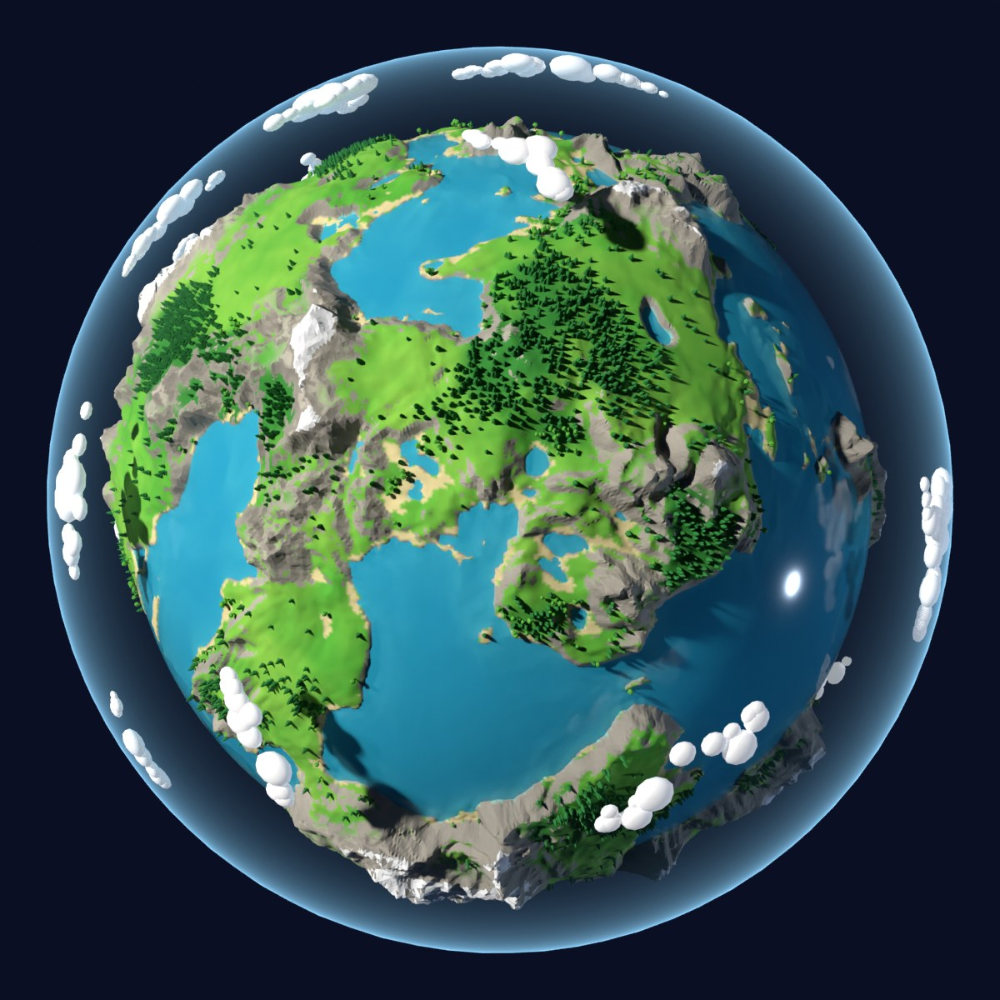
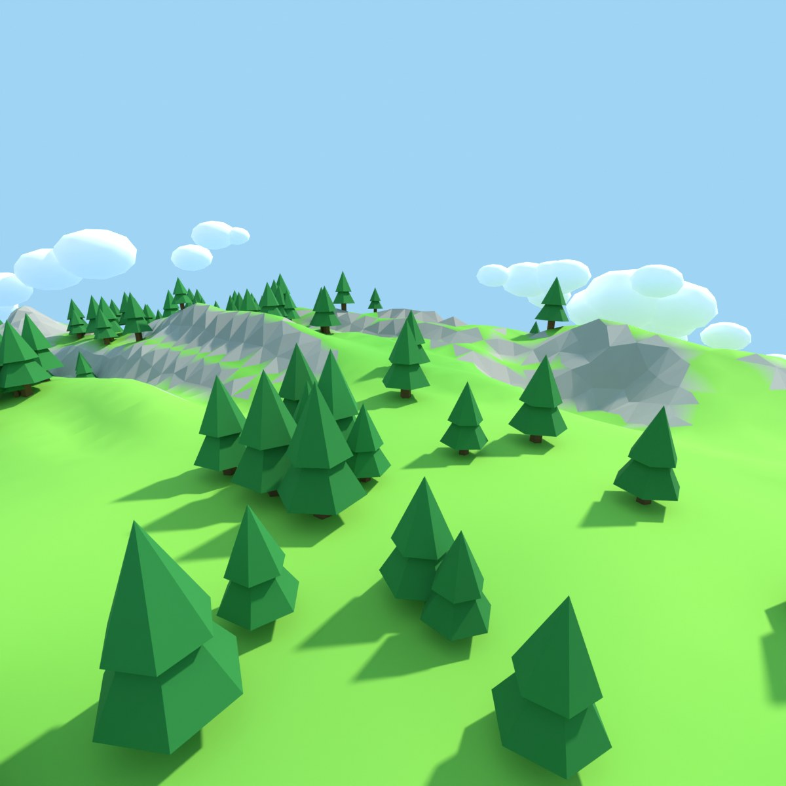

# Orbit Oafs – Worlds

Planet art for **Orbit Oafs**, a game about exploring space and finding habitable planets.

The planets are full size, so a ship can land on them and players can walk
around. They're made by a Blender script: each seed number gives a different
planet. The look is stylized and chunky, with faceted mountains, bright grass,
turquoise water, low-poly forests and puffy clouds.

| From orbit | After landing |
| --- | --- |
|  |  |

## How big is a planet?

The default radius is **500 m**:

- Walking all the way around takes about 10 minutes.
- Mountains are up to about 65 m tall, and oceans about 25 m deep.
- Trees are 6–11 m tall, about 6,000 of them per planet.
- The ground has a point every 3.5 m, so small bumps and rocks show up when you walk.

You can change the radius in the script. Above about 600 m the files get very
big, and it's better to generate the ground inside Godot while the game runs
(see "Next steps").

## What's here

| Path | What it is |
| --- | --- |
| `blender/planet_generator.py` | Builds a planet in Blender and exports it for Godot |
| `godot/orbit_planet.gd` | Godot script: planet gravity, trees, landing sites |
| `godot/planet_walker.gd` | Godot test character for walking around a planet |
| `exports/` | A ready-made example planet (seed 7) |
| `previews/` | Preview pictures |

Each planet export has three files:

| File | What it is |
| --- | --- |
| `earthlike_seed7.glb` | Ground (96 pieces, each with collision), ocean, clouds, landing sites |
| `earthlike_seed7_trees.json` | Where every tree goes |
| `trees_earthlike.glb` | The tree models (shared by every Earth-like planet) |

## Making a planet in Blender

You need Blender 4.2 or newer.

1. Open Blender and click the **Scripting** tab at the top.
2. In the text editor, click **Open** and choose `blender/planet_generator.py`.
3. At the top of the script, change `SETTINGS` if you like:
   - `seed`: any whole number. Each one gives a different planet.
   - `radius`: planet size in metres.
   - `ground_spacing`: metres between ground points. Smaller means more detail but bigger files.
4. Press **Run Script** (the ▶ button). It takes a minute or two, and Blender freezes until it's done.

The files are saved next to your `.blend` file in an `exports` folder. If the
`.blend` isn't saved yet, they go to `orbit_oafs_exports` in your home folder.

From the command line:

```
blender -b -P blender/planet_generator.py -- --seed 7 --render
```

Options: `--seed N`, `--type NAME`, `--radius METRES`, `--spacing METRES`,
`--chunks N`, `--out FOLDER`, `--no-export`, `--render`, `--save-blend`.

## Using a planet in Godot

1. Copy everything from `exports/` and both scripts from `godot/` into your Godot project.
2. Make a new 3D scene with a **Node3D** root, and attach `orbit_planet.gd` to it.
3. Drag `earthlike_seed7.glb` in as a child of that root.
4. Select the root. In the Inspector, set **Trees File** to `earthlike_seed7_trees.json`
   and **Tree Models** to `trees_earthlike.glb`.
5. Add a **DirectionalLight3D** (the sun) and a **WorldEnvironment** for the sky.

The ground gets collision automatically when Godot imports the `.glb`. Every
ground piece is named `...-col`, which tells Godot to add it.

### Walking around to test the size

1. Add a **CharacterBody3D** to the scene and attach `planet_walker.gd`.
2. Give it two children: a **CollisionShape3D** with a capsule shape, and a
   **Camera3D** raised about 0.7 m.
3. On the planet root, set **Start At Landing Site** to the character.
4. Press Play. Use the arrow keys to move, the mouse to look, Space to jump and Esc to free the mouse.

### For your ship and player code

- Gravity pulls toward the planet's centre through an `Area3D`. Rigid bodies
  follow it automatically. In a `CharacterBody3D`, call `get_gravity()` and set
  `up_direction = -get_gravity().normalized()`, like `planet_walker.gd` does.
- `planet.get_landing_sites()` returns flat spots that are good for landing.
  The ground around each one is flattened. Each marker's +Y axis points up.
- `planet.place_at_landing_site(ship)` puts something on a landing site.
- `planet.up_at(position)` gives the "up" direction anywhere on the planet.

## Planet types

| Type | Status |
| --- | --- |
| Earth-like (habitable) | ✅ Done |
| Others (desert, ice, lava, gas giant, …) | Still to be decided |

To add a new type, copy the `"earthlike"` block in `PRESETS` inside the script
and change its numbers and colours.

## Next steps

- A Godot shader for the blue atmosphere glow. In the previews it only exists inside Blender.
- Rocks, boulders and other props on the ground.
- For planets much bigger than 600 m: generate the ground inside Godot while
  the game runs, with more detail near the player. The same shapes and colours
  from this script can be reused.
